# 墨水屏应用平台架构

本文从系统组成、执行流程、数据交接和资源生命周期四个方面说明平台架构，并给出对应源码入口。阅读顺序由整机运行展开到应用开发与构建交付。

## 1. 系统组成与调用关系

### 1.1 整体结构

设备软件由常驻固件和按需装载的动态应用组成。常驻固件提供桌面、文件管理、设置以及应用运行所需的公共能力；动态应用携带自己的页面、业务和资源，通过固件导出的函数调用公共能力。

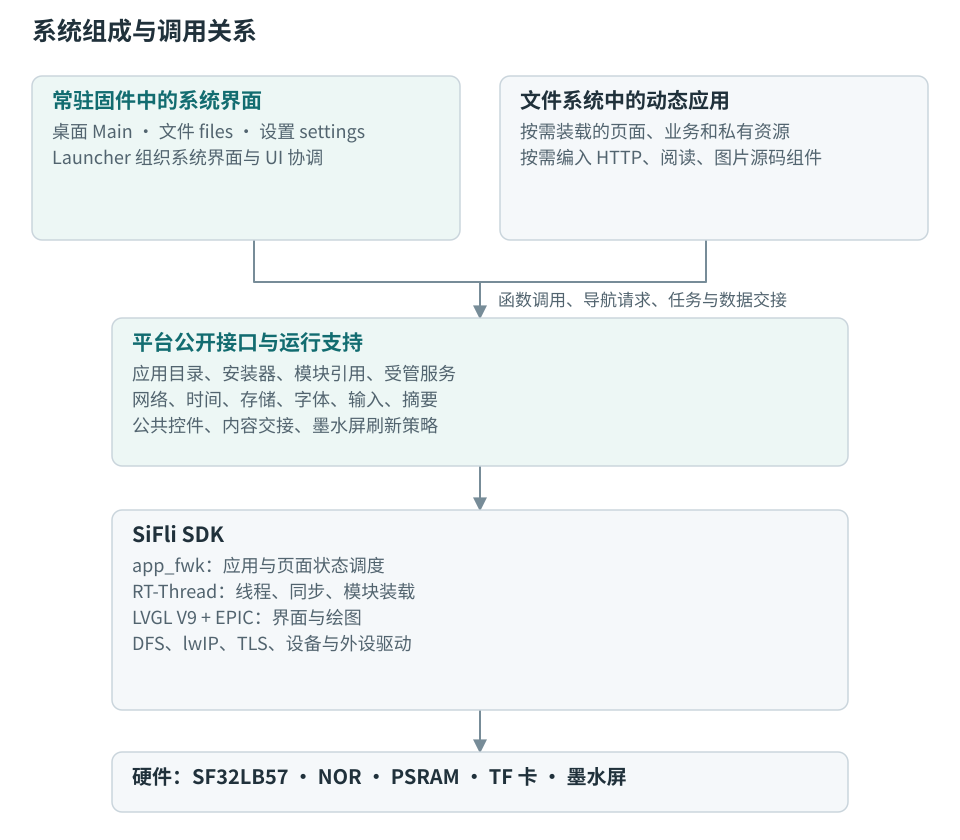

图中的平台接口与 SDK 都编入固件。动态应用使用的函数在加载时解析为固件中的实际地址，调用随后在调用方所属线程中执行。动态模块与固件共享地址空间，模块装载本身不会为每个应用建立独立进程。

两套载板配置分别为 DPI-HDK 和 LCD DevKit，均连接 E0470A03 墨水屏。载板差异由板级配置和引脚适配处理，上层应用使用相同类型的公共接口；具体二进制产物仍按对应板型构建。

### 1.2 Launcher、框架和模块加载器的关系

Launcher 是常驻固件中的系统界面及 UI 协调代码。桌面入口由 `app_home.c` 实现，负责读取应用目录、展示独立图标、切换桌面页和发起启动请求。`launcher.c` 还组织内置页面的创建、前后台处理、系统状态更新，以及安装和存储变化在 UI 线程中的协调。

应用与页面的运行状态由 SDK `app_fwk` 维护。内置页面通过 `ui_navigation.c` 将页面编号映射到应用 ID 和页面名；动态应用直接使用同一框架的页面接口。因此，桌面、设置和动态应用最终进入同一套页面调度。

SDK 模块加载器负责读取共享对象文件（`.so`）、分配装载内存、解析导入符号和完成地址重定位。平台的 `app_catalog.c` 与 `app_module.c` 在加载器外组织应用清单、兼容检查、安装位置、存储会话和模块引用。

这三个部分的衔接如下：

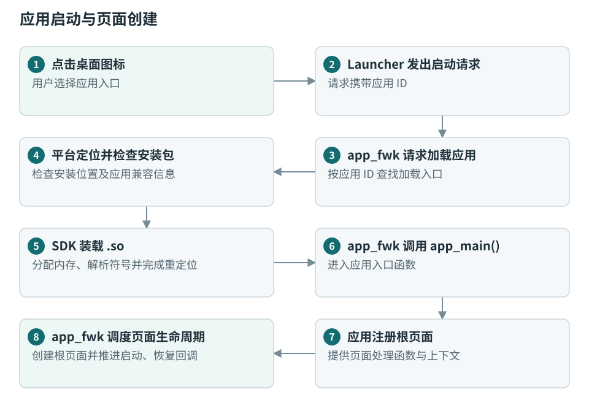

源码入口：[桌面](../src/ui/apps/app_home.c)、[UI 协调](../src/ui/launcher.c)、[内置路由](../src/ui/ui_navigation.c)、[应用目录](../src/ui/platform/app_catalog.c)、[模块管理](../src/ui/platform/app_module.c)。

### 1.3 固件服务与应用内组件

公共能力有两种接入形式：

| 形式 | 代码如何进入程序 | 运行中的使用方式 |
| --- | --- | --- |
| 固件公共服务 | 编入主固件，向动态模块导出函数 | 多个应用调用同一服务，例如网络、存储、受管任务和字体接口。 |
| 应用内源码组件 | 在构建应用时编入该应用或其私有库 | 每个使用者管理自己的实例，例如 HTTP 请求、阅读视图和图片解码。 |

`modules/common/` 中的 HTTP、阅读和图片组件属于第二种形式。它们复用固件提供的网络、内存、文件和图形能力。SD 卡组件则通过项目的 SF-PKG 依赖清单接入固件，由存储服务启动。

动态应用由应用入口、页面、业务状态、后台任务和私有资源组合而成。应用入口注册页面，页面负责交互，业务状态保存内容和操作结果；需要持续运行的工作通过受管服务接入，程序、资源及数据通过应用 ID 关联。

应用按功能需要选择公共接口和源码组件。新增应用沿用相同的安装包、加载、导航和退出机制，应用自身的业务结构在各自设计文档中说明。

## 2. 启动、主循环与线程调度

### 2.1 启动顺序

SDK 完成基础硬件、RT-Thread 和设备初始化后，进入项目的 `main()`。项目启动顺序如下：

1. 初始化 LVGL 与 LCD 接口，建立绘图和帧缓冲资源。
2. 初始化平台内存接口及字体像素缓存的分配、缓存清理回调。
3. 挂载内部文件系统，启动 SD 卡介质服务。
4. 恢复上次未完成的应用安装或卸载事务。
5. 初始化统一网络服务及蓝牙 PAN。
6. 读取系统设置，启动网络校时服务。
7. 初始化字体、Launcher、app_fwk 和应用目录，运行内置 `Main` 根页面。
8. 初始化电池状态、全局输入及启用的诊断功能，然后进入主循环。

SD 卡服务异步完成探卡和挂载。系统界面通过存储状态变化获知卡是否可用，再刷新目录或提示加载卡内应用。

应用目录初始化后，主循环检查已安装应用的后台声明。需要常驻业务的应用可以先加载并启动受管服务，待用户点击入口后再创建页面。

源码入口：[主程序](../src/main.c)、[UI 初始化与处理](../src/ui/ui_app.c)、[文件系统初始化](../src/services/storage.c)。

### 2.2 主线程中的执行顺序

主线程同时承担 UI 事件处理、页面调度和受管服务的 UI 阶段工作：

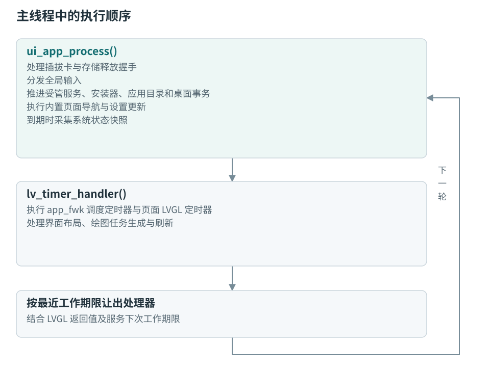

导航适配和输入处理也会在主线程中调用 `gui_app_exec_now()`，立即推进已提交的框架消息。因此，页面切换既可以由框架定时器推进，也可以在当前 UI 操作中完成。

主循环将单次等待上限设为 20 ms，再由 `app_service_ui_delay()` 根据服务声明的最近工作期限缩短等待。这是线程再次处理工作的时间安排；实际屏幕刷新由 LVGL 的脏区域和驱动提交决定。

存储正在等待应用释放资源时，`launcher_storage_process()` 优先推进退出工作，常规输入暂缓分发。这样，文件系统卸载与新的用户文件操作使用同一个协调入口。

### 2.3 线程分工与数据同步

| 执行位置 | 主要工作 | 与其他部分的交接 |
| --- | --- | --- |
| 主线程 | LVGL 对象、页面生命周期、输入、安装协调、服务 UI 回调 | 消费业务快照，提交绘图任务和后台请求。 |
| SDK 绘图线程与 LCD 线程 | EPIC 绘图、帧缓冲处理、面板刷新提交 | 通过 SDK 的完成通知同步绘图和显示资源。 |
| 应用受管工作线程 | 网络访问、文档转换、数据读取与后台保存 | 使用请求队列、受保护的结果和停止事件。 |
| 网络服务线程与 lwIP TCP/IP 线程 | 网络可用性采样、默认网卡和 DNS 更新、事件通知 | 发布带变化代数的网络快照。 |
| 网络校时线程 | NTP 请求和 RTC 更新 | 订阅统一网络事件，独立于应用页面运行。 |
| SD 卡组件线程 | 检测稳定采样、探卡、挂载和卸载 | 发布介质快照，等待平台释放确认。 |
| 安装工作线程 | 应用文件复制、摘要检查和目录事务 | UI 线程先完成停用应用，工作线程再执行文件操作。 |

RT-Thread 当前配置的主线程优先级为 10，网络和 SD 卡服务为 22，网络校时和安装工作线程为 23；应用通过后台描述符指定自己的工作线程参数。绘图、LCD 和通信协议线程按 SDK 配置调度。

涉及 LVGL 对象和字体对象的准备工作在 UI 线程按预算分批推进；使用独立解码状态、文件和原始字体字节的处理可以在工作线程执行。后台发布结果时使用锁保护的数据副本或任务状态，UI 回调在主线程中读取结果并决定是否更新页面。

源码入口：[受管服务](../src/services/app_service.c)、[网络调度](../src/services/net/network.c)、[安装调度](../src/ui/platform/app_installer.c)、[项目线程与图形配置](../project/proj.conf)。

## 3. 动态应用的发现、装载和退出

### 3.1 安装包与应用目录

完整应用包以应用 ID 为目录名，通常包含：

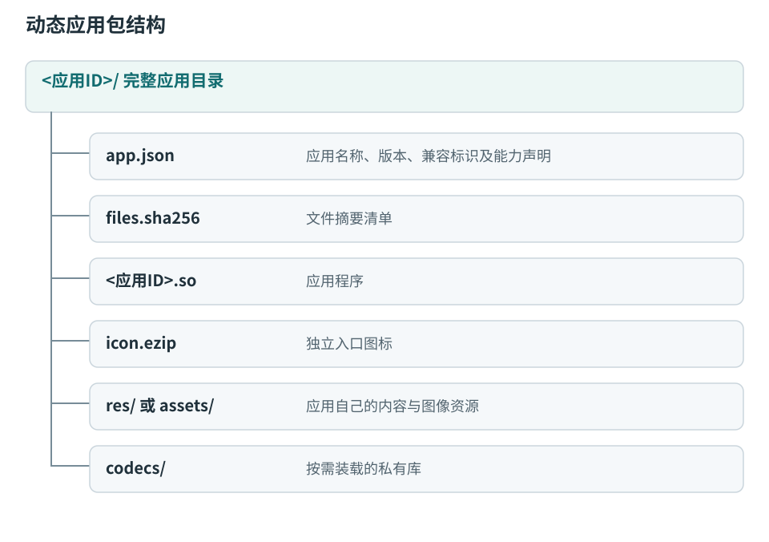

应用目录由内置应用表和已启用安装卷上的应用清单共同生成。桌面读取清单与独立图标即可显示入口；设置页也通过清单查找具有设置入口的应用。目录变化序号用于让消费者判断何时重新枚举。

应用 ID 是安装、运行和数据目录的关联键。相同 ID 同时出现在内部存储与 TF 卡时，安装位置查询优先选择内部安装。运行中的模块记录已绑定的安装位置和卡会话，后续路径解析沿用这一绑定。

### 3.2 从启动请求到根页面

应用打开经过以下步骤：

1. `app_fwk` 根据应用 ID 查找内置应用，或进入平台注册的动态加载入口。
2. 平台检查恢复模式、安装事务和安装卷是否允许启动。
3. 在存储锁内读取安装清单，检查包格式、平台兼容标识、摘要清单、应用程序摘要与 ELF 装载结构。
4. `app_module_open()` 建立或复用该应用的模块记录，并调用 SDK `dlopen()`。
5. SDK 分配模块内存、装入代码和数据、解析导入符号、重定位，随后执行模块初始化。
6. 平台取得 `epd_app_info` 和 `app_main`，检查应用描述符；如有后台声明，则启动对应受管服务。
7. 框架调用 `app_main(intent)`，应用注册根页面处理函数和页面上下文大小。
8. 框架创建根页面，依次推进启动和恢复回调。

安装时执行整个包的完整文件检查；打开应用时检查装载所需内容，私有库在打开时单独检查。平台在调用 `dlopen()` 之前完成包级准入，因为模块初始化已经会执行应用代码。

应用导入的公共函数由固件的 RT-Thread 导出符号表提供，`EPD_APP_DEFINE()` 则将应用描述符和平台兼容指纹写入模块。接口声明、结构体布局和编译配置共同决定应用与固件能否配套使用。

源码入口：[包检查](../src/ui/platform/app_package.c)、[动态加载入口](../src/ui/platform/app_catalog.c)、[模块引用与安装卷绑定](../src/ui/platform/app_module.c)、[应用公开接口](../src/ui/platform/epd_app.h)、[运行库导出](../src/ui/platform/app_runtime.c)。

### 3.3 页面引用与后台引用

应用页面和后台服务分别持有模块引用。关闭最后一个页面会释放页面侧引用；仍在执行网络同步、保存或其他后台工作的服务继续持有自己的引用，模块代码因此继续驻留。

受管服务使用应用导出的 `epd_app_background` 描述符。描述符可以提供工作线程入口 `run`、主线程回调 `ui_process`、命令入口和保存回调。平台负责创建事件对象、启动线程、绑定网络订阅，并记录应用的安装卷和存储会话。

停止过程为：

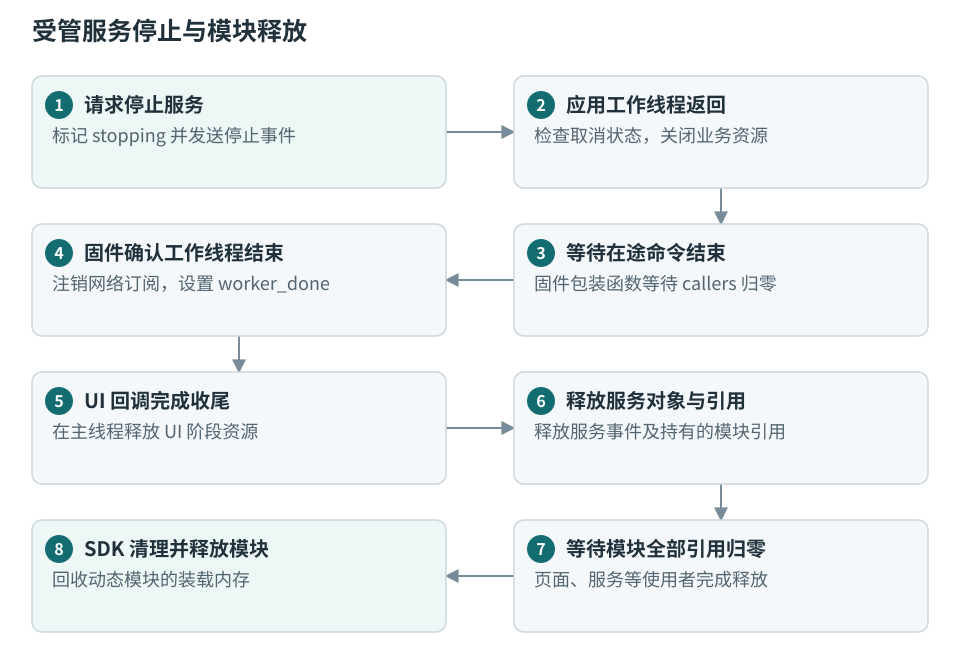

`ui_process` 由主循环调用；应用通过 `epd_service_ui_request()` 声明下一次需要处理的期限。期限参与主循环等待时间的计算，具体回调仍需根据任务状态决定本轮处理量。

后台启动流程也复用同一加载入口：平台取得一个临时引用，启动服务后释放临时引用，由服务继续持有模块。这样，后台任务和页面打开可以共享同一份应用全局业务状态。

### 3.4 私有库与资源释放

应用通过 `epd_app_library_open()` 打开安装包 `codecs/` 中的私有库。平台检查库的声明、摘要和装载信息，再使用同一模块管理器记录引用。应用取得符号后可以在业务流程中调用库函数。

私有库返回的结果、工作线程和回调与库代码具有共同生命周期。应用先结束使用这些对象的任务，释放库拥有的结果，再关闭私有库；应用本身的最终卸载位于这些收尾动作之后。

平台使用受管服务和模块引用表达“代码仍被使用”的关系，业务代码负责关闭自身文件、连接、定时器和数据对象。两者共同构成完整的退出流程。

源码入口：[服务接口与停止协议](../src/services/app_service.h)、[服务实现](../src/services/app_service.c)、[私有库入口](../src/ui/platform/app_library.c)。

## 4. 页面、输入与显示流程

### 4.1 页面状态与对象生命周期

`app_fwk` 通过消息邮箱接收导航请求，再由调度器改变应用和页面的目标状态。框架的调度定时器由 LVGL 驱动，本项目的生命周期回调在主线程执行。页面回调中产生的新导航请求仍进入框架消息队列，由后续调度处理。

框架为页面创建屏幕根对象和页面上下文。页面代码在根对象下创建控件，并管理页面专属的定时器、订阅和业务引用。

| 生命周期 | 框架执行的动作 | 页面执行的动作 |
| --- | --- | --- |
| `ONSTART` | 创建并临时切入页面 screen，提供页面上下文 | 创建控件、输入组和页面专属资源。 |
| `ONRESUME` | 将页面 screen 切为前台，更新活动页面 | 读取最新业务数据，恢复选择与滚动位置，启用前台更新。 |
| `ONPAUSE` | 将页面转为暂停状态 | 保存操作状态，暂停页面定时器和前台专属工作。 |
| `ONSTOP` | 调用清理回调，再删除 screen，回收页面节点和上下文 | 删除自建定时器、解除订阅、释放自有引用并清空外部指针。 |

暂停页面的 screen 和上下文仍然存在，直到框架执行 `ONSTOP`。框架停止当前页面时，会先让其他页面成为活动 screen，再删除旧 screen。因此，返回时可能先收到上一页的 `ONRESUME`，再收到退出页的 `ONSTOP`。

由平台创建的输入组、公共状态栏等附属资源，绑定根对象的删除事件释放；控件树随 screen 删除。页面自己的定时器不属于控件树，需要在生命周期中单独处理。

选择位置、输入草稿、阅读光标等由各页面或业务状态保存。页面仍处于暂停状态时可以使用保留的上下文；页面已经销毁后，重新进入时从保存的数据恢复。

源码入口：[SDK 框架入口](../SiFli-SDK/middleware/app_fwk/gui_app_fwk.c)、[SDK 页面状态机](../SiFli-SDK/middleware/app_fwk/app_schedule.c)、[内置页面生命周期](../src/ui/launcher.c)。

### 4.2 导航与返回关系

应用根页面通过 `gui_app_regist_msg_handler_ext()` 注册，子页面通过 `gui_app_create_page_for_app_ext()` 创建。返回上一页使用 `gui_app_goback()`，回到已存在的指定页面使用 `gui_app_goback_to_page()`，结束应用使用 `gui_app_exit()`。

内置路由先判断目标页面是否存在：存在时返回该页面，否则创建。动态应用使用自己的页面名组织业务，但页面关系仍由同一个框架维护。

典型导航如下：

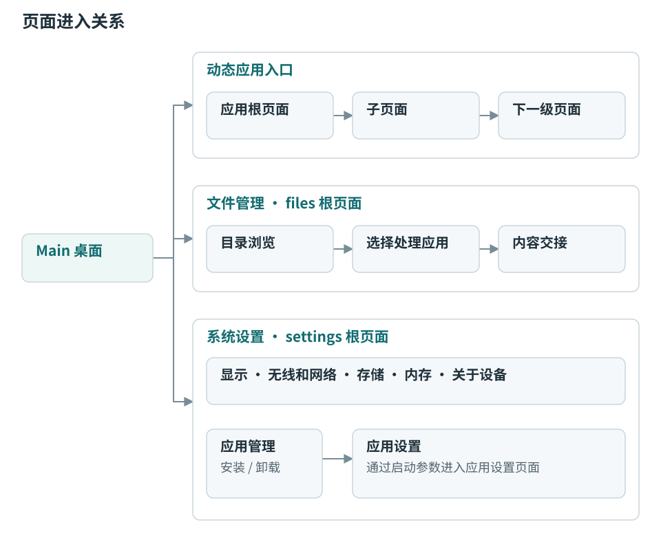

共享文本设置和锁屏可以作为当前应用的子页面打开。返回时由框架恢复下层页面，页面代码恢复自己的焦点和显示数据。应用管理打开动态应用设置时，通过启动消息中的 `page=settings` 参数，让应用选择设置入口作为根页面；具体设置内容仍由应用创建。

### 4.3 输入接收与分发

触摸通过 SDK 的 LVGL 输入设备进入控件事件。开发板按键由全局输入适配转换为上一项、下一项、确认和返回，并进入统一队列。

输入处理分为接收与分发两步。刷新期间可以继续接收按键；UI 线程在刷新就绪后处理队列。相邻的方向操作合并为一组，页面可以一次移动到最终目标；确认和返回保留在原顺序位置。阅读页通过自己的输入回调处理受控待翻页请求。

每个页面和弹窗可以建立受管输入组。平台优先选取当前 screen 中可见的弹窗输入范围，再使用页面输入组；标准按钮自动加入对应组。弹窗删除后，其输入组随根对象释放，下层页面重新接收输入。

焦点样式使用白色背景和加粗黑色边框。焦点变化、控件点击及触摸操作最后都进入页面事件处理，不需要每个应用再次注册板级按键驱动。

源码入口：[全局输入](../src/ui/platform/epd_input.c)、[公共控件与输入组](../src/ui/platform/epd_app.c)。

### 4.4 从业务数据到屏幕像素

界面更新从业务数据变化开始。平台的 `epd_app_text()` 保存设置给标签的原始文字，后续更新先比较原始文字；文字相同时不再次设置标签。这个比较发生在 LVGL 对文字进行省略或排版之前。

完整显示流程为：

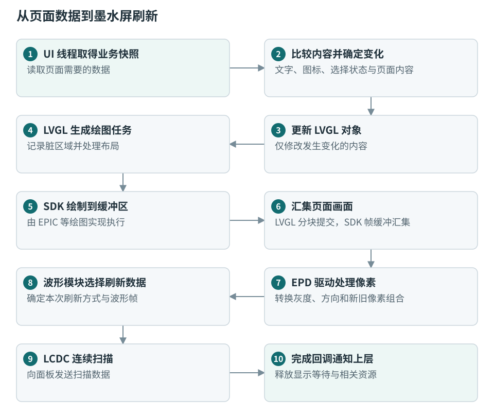

界面采用 684 × 1216 竖屏坐标。当前 LVGL 使用 RGB565、两个 40 行绘图缓冲，缓冲放在 PSRAM；驱动按面板扫描所需的数据布局处理画面。LVGL 提交的脏区域用于描述本次变化，面板实际如何扫描由 EPD 驱动完成。

应用直接创建控件或提交已经解码的图像结果。JPEG、PNG 和文档图片的文件读取与解码放在业务工作流程中完成，再交给 UI 使用，避免把耗时文件解码嵌入每次控件绘制。

### 4.5 全刷策略与面板电源

`epd_refresh.c` 同时观察 app_fwk 生命周期和 LVGL 刷新事件，记录当前前台 screen、本帧各提交区域以及最近已提交的 screen。在最后一个 LVGL 分块提交时，确定这一帧的刷新语义。

| 画面变化 | 提交给驱动的方式 | 周期计数 |
| --- | --- | --- |
| 前台 screen 与上次提交不同 | 全刷 | 归零。 |
| 同一页面的正文或其他内容变化 | 自动选择全刷或局刷 | 累计，并按用户设置的周期触发全刷。 |
| 同一页面仅已登记状态栏区域变化 | 指定局刷 | 保持不变。 |
| 显式请求全刷 | 全刷 | 归零。 |

状态栏判定覆盖本帧全部提交区域；只要有区域超出登记范围，本帧就按内容更新处理。周期计数由波形模块统一维护。

E0470A03 驱动根据刷新方式、温区及波形配置选择实际波形帧。常规局刷路径将灰度未变化的像素设为不驱动，保留新旧像素关系用于下一次刷新。

最后一帧扫描完成后，驱动通知 SDK 刷新完成，同时记录空闲时间并唤醒电源线程。电源线程在配置的空闲等待结束后关闭面板供电；新刷新到来时重新检查活动状态。上电、放电和供电状态受互斥锁保护，界面恢复处理与面板电源收尾可以分别推进。

源码入口：[刷新语义](../src/ui/platform/epd_refresh.c)、[屏幕驱动](../src/boards/epd_e0470a03_57x/epd_e0470a03.c)、[波形与周期](../src/boards/epd_e0470a03_57x/epd_waveform.c)、[供电时序](../src/boards/epd_e0470a03_57x/epd_tps.c)。

## 5. 公共服务与应用数据交接

### 5.1 系统状态和应用摘要

`ui_app.c` 汇集时间、电量、充电、蓝牙状态以及平台接收的业务状态和应用摘要，形成系统状态快照。主线程定期采集快照，Launcher 和公共状态栏比较需要显示的字段，再更新对应控件。

应用摘要是受管服务保存在固件中的文字副本。发布者调用 `epd_service_publish_summary()`，消费者按服务 ID 读取摘要和变化序号。文字相同时保持序号不变，服务停止后停止对外提供该摘要。

完整业务数据由应用维护。工作线程完成数据获取和处理后，在同步保护下发布结果；应用页面在 UI 线程复制业务快照并格式化显示。需要向其他界面提供简短信息时，应用另行发布公共摘要，由消费者按服务 ID 读取。

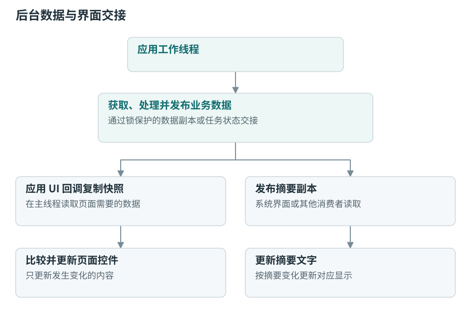

这条交接路径中的平台记录保存数据副本，不持有应用页面控件或应用临时字符串。

源码入口：[系统状态](../src/ui/ui_app.c)、[服务摘要](../src/services/app_service.c)。

### 5.2 统一网络状态与多使用者通知

网络服务将网卡状态整理为 `network_snapshot_t`，其中包含是否可用、当前来源、地址和变化代数 `generation`。代数标识一轮网络环境；连接失效、地址或选路变化后，应用可以识别旧请求对应的环境已经改变。

网络驱动和 lwIP 的状态变化先唤醒网络服务。网络服务通过 `tcpip_callback()` 在 TCP/IP 线程采样网卡状态、更新默认网卡和 DNS，再发布一致的快照，向各订阅者发送 RT-Thread 事件。

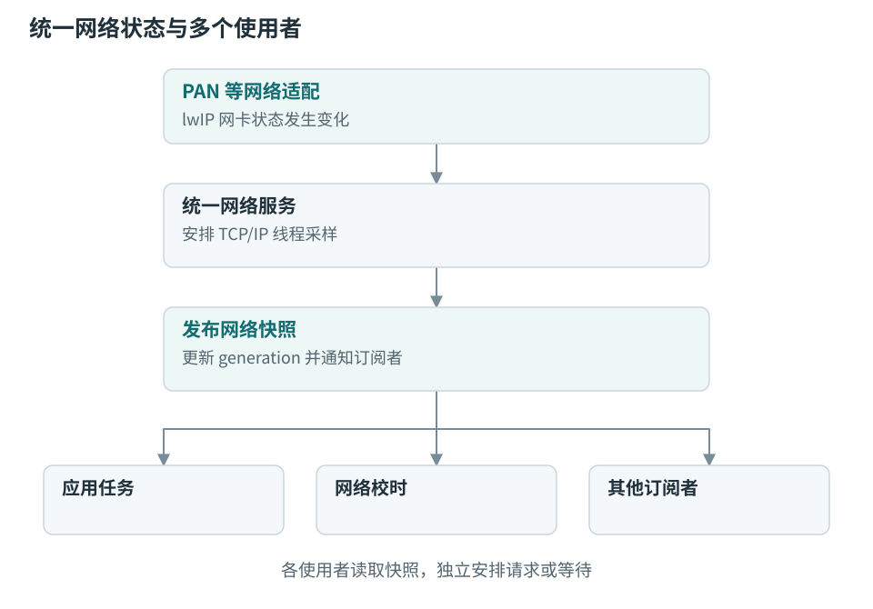

订阅者提供事件对象并持有订阅令牌。服务在锁内维护订阅列表和事件发送；注销完成后，订阅者再释放事件对象。网络层发送事件，不直接调用应用页面。

PAN 适配连接当前 SDK 蓝牙网络。网络服务还提供网卡登记、网络来源选择和 DNS 设置接口，供网络适配层使用；应用读取统一快照，业务请求不需要直接检查 PAN 的内部状态。

### 5.3 HTTP、TLS 与网络校时

公共 HTTP 源码组件处理连接、请求发送、响应头和正文接收，并将错误保留到具体请求阶段。TLS 使用 SDK 的 mbedTLS、证书配置及平台内存适配；应用在 HTTP 结果之上解析业务内容并处理业务错误。

HTTP 组件编入使用者，网络请求及响应缓冲由调用它的业务任务管理。页面只接收任务状态和处理后的数据。

系统校时由独立的 `net_time` 线程处理。该线程订阅统一网络事件，在新网络环境可用后请求配置的 NTP 服务器，成功后写入 RTC。当前默认服务器为 `ntp.aliyun.com`。网络代数变化时，校时流程按新的网络环境重新安排，系统时钟由公共状态快照显示。

源码入口：[网络接口](../src/services/net/network.h)、[网络实现](../src/services/net/network.c)、[PAN 适配](../src/services/net/bt_pan.c)、[HTTP 组件](../modules/common/http/epd_http.c)、[TLS 内存适配](../src/services/net/tls_memory.c)、[网络校时](../src/services/net/network_time.c)。

### 5.4 文件内容交接与应用设置入口

应用通过安装清单声明能够处理的文件类型。文件管理器查询可用处理者，用户选择后，平台生成 app_fwk 启动消息，即 `Intent`，交给目标应用。

内容消息携带路径、请求序号，以及卡上文件对应的存储会话。接收方重新检查路径和会话后，复制路径并启动自己的读取流程。消息传递的是可重新验证的内容描述，而不是已打开文件句柄或发送页面的对象地址。

应用设置使用相同的启动消息机制。系统设置发现清单中的设置能力后，以 `page=settings` 启动目标应用，由目标应用解释该参数并创建设置页面。

源码入口：[内容交接](../src/ui/platform/app_content.c)、[应用管理入口](../src/ui/apps/app_management.c)、[内容处理协议](CONTENT_HANDLERS.md)。

### 5.5 阅读与图片处理组件

共享阅读组件位于 `modules/common/reader/`。应用向组件提供内容标识、标题、缓存位置、阅读光标和资源读取接口；组件负责阅读视图、分页状态和字体准备。应用继续保存自己的业务状态、内容来源及使用进度。

阅读处理分为工作线程阶段和 UI 阶段。工作线程读取或转换内容、获取图片资源，并准备可交接的数据；UI 阶段按预算完成依赖 LVGL 的分页测量和页面绑定。阅读位置使用内容记录与字节位置表示，分页结果则与字体和布局参数关联。分页完成后通过状态变化让阅读页更新总页数。

图片组件位于 `modules/common/image/`，提供 PNG、JPEG 解码、等比缩放和灰阶输出。PNG 使用逐行解码流程；JPEG 根据编码形式和实际缓冲分配结果选择 SF32LB57 硬件解码或流式软件路径。硬件访问通过固件 `epd_image.c` 封装，解码任务负责取消检查和结果释放，UI 持有显示期间所需的结果引用。

阅读组件通过自己的构建脚本组合共享视图和所需文档处理源码；应用使用的是编入自身的代码实例，不通过启动另一个应用来获得阅读能力。

源码入口：[阅读组件接口](../modules/common/reader/reader.h)、[阅读组件说明](../modules/common/reader/README.md)、[图片解码入口](../modules/common/image/raster_decode.c)、[PNG 解码](../modules/common/image/raster_png.c)、[JPEG 解码](../modules/common/image/raster_jpeg.c)、[硬件图片服务](../src/platform/epd_image.c)。

## 6. 存储布局、安装事务与热插拔

### 6.1 文件系统与应用路径

RT-Thread 的文件系统层 DFS 将不同介质挂到统一目录树中：根目录使用 ROMFS，设备节点位于 `/dev`，内部 NOR 的 LittleFS 挂载到 `/flash`，TF 卡的 FatFs 挂载到 `/sdcard`。

应用通过 `storage_app_path()` 查询程序、业务数据和缓存路径。函数先找到应用安装卷；应用已经加载时，使用模块绑定的安装卷和会话。

| 内容 | 内部存储安装 | TF 卡安装 |
| --- | --- | --- |
| 程序及随包资源 | `/flash/apps/<id>/` | `/sdcard/.epd/apps/<id>/` |
| 持久化业务数据 | `/flash/data/<id>/` | `/sdcard/.epd/data/<id>/` |
| 可重建缓存 | `/flash/cache/<id>/` | `/sdcard/.epd/cache/<id>/` |

用户内容可以位于应用安装卷之外。应用安装在内部存储时，即使打开的是 TF 卡文件，业务记录仍保存到内部应用数据目录；应用安装在 TF 卡时，业务记录则保存在卡上的应用数据目录。

待安装目录 `/sdcard/apps/<id>/` 用于交付应用包，安装后的运行目录由用户选择的目标卷决定。平台自己的设置、恢复记录、安装事务和导入字体分别保存在内部系统目录中。

持久化辅助接口提供带类型标识、版本、长度和 CRC 的记录格式，并通过临时文件、替换和恢复过程提交记录。业务数据的字段解释与版本迁移由应用完成。

源码入口：[存储服务](../src/services/storage.c)、[路径与持久化](../src/services/storage_file.c)、[公开存储接口](../src/services/storage_file.h)。

### 6.2 NOR 分区与文件系统的关系

两套 SF32LB57 板级配置中的 NOR 映射基址为 `0x12000000`。板级分区表声明的区域如下，容量采用二进制单位，1 KiB = 1024 字节，1 MiB = 1024 KiB。

| 分区 | 起始地址 | 容量 | 内容 |
| --- | --- | --- | --- |
| `main:1` | `0x12020000` | 2 MiB | 主固件代码镜像。 |
| `main:2 / BUILTIN_RESOURCE` | `0x12220000` | 8 MiB | 内置字体等固件公共资源。 |
| `acpu` | `0x12A20000` | 128 KiB | ACPU 镜像区域。 |
| `ble_store` | `0x12A40000` | 16 KiB | 蓝牙持久化数据。 |
| `wave_table` | `0x12A44000` | 256 KiB | 墨水屏波形数据。 |
| `fs_root` | `0x12A84000` | 5616 KiB | 内部 LittleFS 文件系统。 |

应用包和应用数据存放在 `fs_root` 内的普通目录，动态安装改变文件系统内容，不为每个应用新增 Flash 分区。构建使用同一分区表生成内存映射和镜像下载地址。

分区入口：[DPI-HDK](../project/dpi-hdk_lb57gyd7n6_epd_hcpu/ptab.json)、[LCD DevKit](../project/sf32lb57-lcd-gyd7n6_epd_hcpu/ptab.json)。

### 6.3 安装、更新和卸载事务

安装器由 UI 协调部分和文件工作线程组成。UI 协调部分先请求目标应用退出，停止服务，并等待模块引用释放；工作线程取得准备完成信号后，才进入存储锁内操作文件。

安装和更新依次执行：

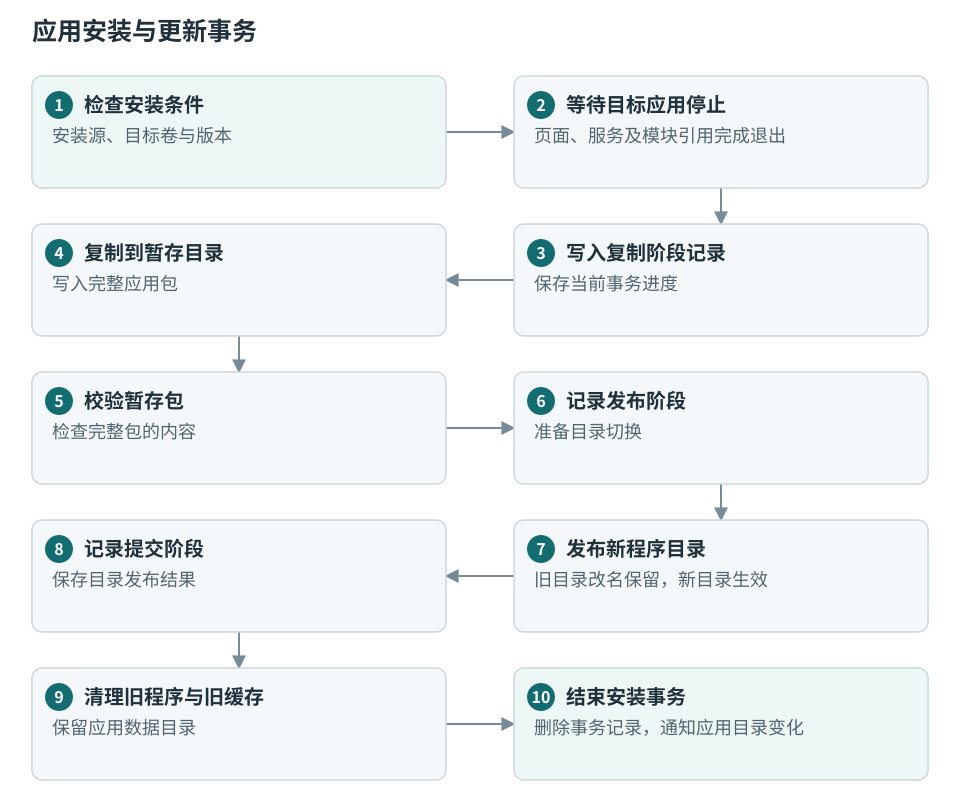

事务记录表示文件操作已经推进到哪一步。启动或安装卷重新就绪时，安装器读取记录，按已发生的目录变化继续收尾或恢复旧程序。内部卷和 TF 卷各自保存事务信息。

更新保留应用数据目录，清理可重建缓存。卸载先将程序目录改名为待删除目录，再按事务记录完成删除并清理缓存；现有数据目录保留，重新安装时由应用继续读取或迁移。

安装任务完成后更新应用目录变化序号，桌面和设置重新枚举相应条目；后台服务启动流程也随目录变化重新检查。

源码入口：[安装器与事务恢复](../src/ui/platform/app_installer.c)、[应用包验证](../src/ui/platform/app_package.c)。

### 6.4 TF 卡会话与退出握手

SD 卡组件维护介质状态、挂载事实、可访问状态和会话编号。`available` 表示当前是否允许开始访问；`session` 标识本轮卡会话；`revision` 表示快照发生变化。打开任务时保存会话编号，执行文件访问时检查会话仍然有效。

拔卡流程为：

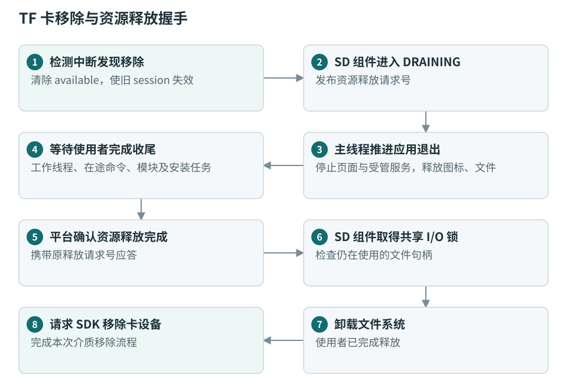

当前平台在拔卡时统一停止动态应用，包括安装在内部存储中的动态应用，因为这些应用也可以读取卡上内容。内置界面继续承担退出协调和后续状态展示。

退出确认携带请求号，使确认动作对应正在处理的那次移除。等待释放超时时，组件记录异常并继续保留尚被使用的对象；文件系统卸载以使用者完成释放为前提。已进入驱动的读写仍由驱动返回实际结果。

插卡时，组件完成检测稳定采样、探卡和 FAT 挂载，发布新会话。平台发现卡内已安装应用后，弹出是否加载的确认；用户接受后才将本轮会话标记为允许加载应用，处理安装恢复并刷新应用目录。旧任务保存的会话号不会随新卡自动更新。

源码入口：[SD 卡状态机](../components/sdcard/src/sdcard.c)、[SDK SDIO 适配](../components/sdcard/port/sdcard_sifli_sdio.c)、[插卡确认](../src/ui/platform/app_card.c)、[平台释放协调](../src/ui/launcher.c)、[模块释放协调](../src/ui/platform/app_catalog.c)。

## 7. RAM、字体和图像资源管理

### 7.1 内存区域与分配入口

设置页将片内 SRAM 标为 RAM0，将外部 PSRAM 标为 RAM1。固件静态数据、线程栈、堆、模块代码和图像缓冲分别占用其中的相应区域。

| 内存用途 | 分配或布局方式 | 生命周期 |
| --- | --- | --- |
| 固件静态数据和固定缓冲 | 链接脚本及板级内存映射 | 固件运行期间保留。 |
| RT-Thread 对象及系统堆 | 系统堆 `heap` | 由线程、服务或对象创建者释放。 |
| LVGL 对象和相关数据 | PSRAM 专用堆 `lv_psram`，当前配置为 2 MiB | 随控件、页面和 LVGL 资源释放。 |
| 动态模块、应用大缓冲和图像资源 | SDK 共享 PSRAM 堆 `app_image_psram_memheap`，当前配置为 11 MiB | 随模块引用、任务和缓存使用情况分配与回收。 |
| LVGL 绘图缓冲和显示相关数据 | 图形配置指定的 PSRAM 区域 | 由图形系统管理。 |

`epd_app_alloc()` 让应用明确选择 SRAM 或 PSRAM，`epd_app_realloc()` 在对应内存池调整大小，`epd_app_free()` 根据实际分配归属释放。动态模块通过 SDK 配置的模块内存分配接口进入共享内存池。

设置中的内存页读取区域总量及各内存池剩余容量，计算 RAM0、RAM1 的整体使用情况。具体容量由最终构建配置、链接结果和运行时分配共同决定。

源码入口：[应用内存接口](../src/platform/epd_memory.c)、[内存统计](../src/ui/platform/app_memory_usage.c)、[内存页](../src/ui/apps/app_memory_page.c)、[内存配置](../project/proj.conf)。

### 7.2 字体文件、字体对象和字形缓存

字体处理包含三类对象：

1. **字体原始数据**保存字符轮廓与字体表。内置 MiSans 以压缩资源进入固件，启动时解压到共享 PSRAM，并在固件运行期间保留。
2. **字体对象**将字体数据与字号、字重和后备字体关联，供排版与绘制调用。
3. **字形缓存**保存已经计算的字符度量、字形像素和派生效果，减少后续重复计算。

页面使用平台提供的公共字号字体；阅读等业务按自己的字号创建字体对象。用户导入字体先保存到内部字体目录，再由字体管理代码读取和建立对象，页面引用与字体数据的生命周期分别维护。

阅读字形缓存采用按使用情况淘汰的缓存组织，并对正在绘制的字形保持引用。预备相邻页字符时，UI 阶段等待绘图就绪后分批准备；模块或私有库装载需要空间时，可以先回收可淘汰的阅读缓存，再执行实际分配。

应用销毁字体对象之前，先解除页面对该字体的使用，并释放相关缓存引用。内置字体原始数据是固件级资源，工作线程可读取平台提供的只读字节视图；操作 LVGL 字体对象仍在相应 UI 或绘图调用路径中完成。

源码入口：[字体创建与原始数据](../src/ui/ui_font.c)、[阅读字形缓存](../src/ui/ui_reader_font_cache.c)、[字体像素分配适配](../src/ui/platform/app_memory.c)。

### 7.3 图像结果、缓存和硬件可见性

图片解码工作缓冲、缩放后的灰阶结果和 UI 图像描述符具有不同生命周期。工作缓冲在解码结束或取消时释放；用于显示的结果在控件仍引用它时保留；缓存可以持有可再次使用的结果，但必须在替换或释放前结束原使用者的访问。

CPU、EPIC 和 LCDC 可能依次使用同一片 PSRAM。当前 PSRAM 采用写回缓存配置，因此 CPU 写出的数据在交给硬件读取前需要执行对应缓存维护。字体像素路径通过平台注册的清理回调完成这一交接；显示和硬件图片路径使用各自驱动的缓冲处理流程。

资源管理由三个范围共同决定：页面决定控件何时停止使用资源，业务任务决定计算何时结束，缓存或模块引用决定资源最终何时可释放。这些关系通过具体对象引用和完成状态表达。

源码入口：[字体缓存清理接入](../src/main.c)、[图片内存与解码](../modules/common/image/raster_alloc.c)、[硬件图片服务](../src/platform/epd_image.c)。

## 8. 错误处理、故障现场与恢复

### 8.1 可返回错误的处理路径

文件读取、网络请求、内存分配和应用加载等操作通过返回值或任务结果向调用方报告失败。工作线程将失败阶段和业务状态交给 UI，页面再显示对应信息；任务结束同时关闭已打开句柄并释放本次分配。

安装器保留事务阶段，存储服务保留介质状态，应用模块管理器保留有效引用。这些状态决定失败后哪些对象仍需收尾，以及下一次操作从何处重新开始。

业务错误通过应用状态处理；处理器异常和系统断言则进入 SDK 的故障取证路径。由于动态应用与固件共享地址空间，故障现场需要同时包含固件和相关动态模块的信息。

### 8.2 发布符号与装载地址

故障分析使用两类信息将设备地址对应到源码：

- 开发者保存的发布文件提供主固件、应用和私有库的配套调试符号。
- SDK 模块运行对象中的执行内存地址和 ELF 装载起点，用于计算符号在设备上的地址。

模块装载、重定位和释放沿用 SDK 实现。调试器或包含模块对象的转储提供实际运行地址，开发者根据设备运行版本选择对应符号文件。

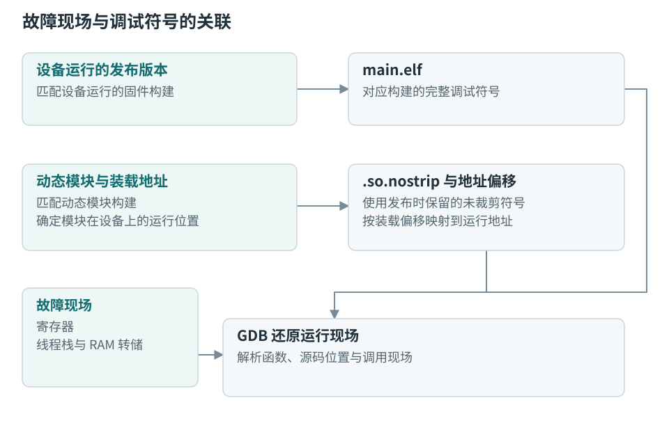

连续 RAM 装载路径的地址偏移按 `exec_mem_space - vstart_addr` 计算，用于将原 ELF 符号放到运行地址。

### 8.3 断言、异常和卡顿取证

断言和异常使用 SDK 原有的保存与处理流程。动态模块主线程触发断言时，SDK 保留模块线程退出分支；主 UI 线程或其他系统线程中的终止性故障使用系统故障路径。

诊断输入包括故障寄存器、线程与模块对象、相关栈及动态执行区域。动态模块装入 PSRAM 时，相应 PSRAM 也是故障现场的一部分。

可选 `HANG_DIAG=1` 启用运行阶段和线程状态监测，便于识别长时间未完成的 UI、绘图或显示阶段。监测线程能运行时可以输出诊断；处理器已经无法调度时，通过调试器暂停并导出现场。

具体符号选择和 GDB 操作见[动态应用故障取证](DYNAMIC_APP_DEBUGGING.md)。源码入口：[SDK 模块对象](../SiFli-SDK/rtos/rtthread/components/libc/libdl/dlmodule.h)、[卡顿诊断](../src/platform/hang_diag.c)。

### 8.4 恢复模式

恢复模式在系统启动时读取内部存储中的选择记录，也可以通过 `APP_RECOVERY=1` 构建参数固定启用。恢复模式在进入模块加载器之前阻止动态执行，同时保留内置桌面、文件和设置功能。

普通运行中修改恢复选择会保存“下次启动”的状态，重启后应用。恢复模式使设备能够进入内置管理界面，处理有问题的应用包，再切回正常启动。

源码入口：[恢复状态与持久化](../src/ui/platform/app_recovery.c)、[恢复操作](RECOVERY.md)。

## 9. 源码组织、构建与扩展接入

### 9.1 源码入口

| 目录 | 组织内容 |
| --- | --- |
| `project/` | SCons 主构建、通用与板级配置、分区、组件依赖和产物目录。 |
| `boards/` | 项目新增的载板定义及硬件适配。 |
| `src/boards/` | 屏幕、输入、电池、触摸、SD 引脚等项目侧设备接入。 |
| `src/platform/` | 内存、硬件图片和卡顿诊断支持。 |
| `src/services/` | 存储、持久化、网络、时间和应用受管服务。 |
| `src/ui/platform/` | 应用目录、安装、模块引用、公共 UI、输入、刷新和内容交接。 |
| `src/ui/apps/` | 内置桌面、文件管理、设置及其页面。 |
| `modules/<id>/` | 动态应用的页面、业务、资源、设计说明和私有构建。 |
| `modules/common/` | 随使用者构建的 HTTP、阅读和图片源码组件。 |
| `components/sdcard/` | SD 卡组件源码、SDK 适配、包定义和测试。 |
| `tools/` | 应用打包、开发包导出、制镜、发布检查与主机测试。 |
| `docs/`、`doc/` | Markdown 文档源文件，以及网页知识库入口与生成内容。 |

运行时依赖由公开接口和服务建立；构建时依赖由 SCons、板级配置和 SF-PKG 清单组合。新增应用、组件或板级适配分别沿对应入口接入。

### 9.2 固件与应用的构建关系

平台构建生成固件镜像、配置和导出接口信息。动态应用构建读取已经完成的平台构建结果，沿用其头文件路径、编译选项及兼容指纹，再检查应用导入的符号是否由固件提供。

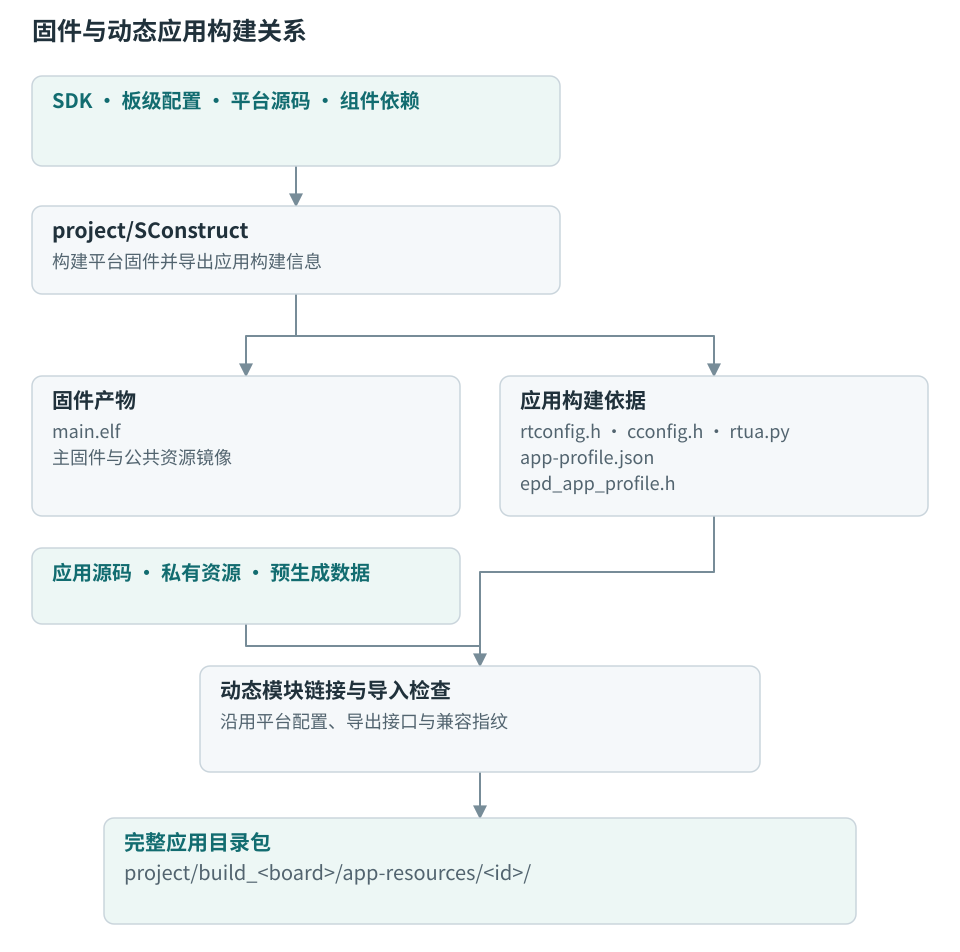

`app-profile.json` 的指纹覆盖 SDK 及其相关修改、工具链、模块编译链接参数、最终配置和公共接口内容。设备用该指纹判断安装包是否与当前固件配套。

相关版本字段分别承担以下作用：

| 字段 | 表达的关系 |
| --- | --- |
| 包格式与接口版本 | 安装清单、模块描述符采用的结构约定。 |
| 应用版本 | 应用程序和随包内容的发布版本。 |
| 数据版本 | 应用持久化数据的格式及迁移关系。 |
| 平台兼容指纹 | 应用编译环境与设备固件是否配套。 |

`APPS` 选择本次构建的应用；`PREINSTALL` 选择进入出厂文件系统的应用，并将这些应用加入构建集合。两者可单独使用，也可以组合。

源码入口：[平台构建](../project/SConstruct)、[应用构建与打包协调](../tools/native_apps.py)、[兼容指纹](../tools/app_profile.py)。

### 9.3 文件系统制镜与部署

平台构建使用 SDK 原生 LittleFS 制镜工具，将 `disk/` 的初始内容和选中的预装包写入 `fs_root.bin`。该镜像是一份内部文件系统初始内容，包含预装应用时，应用以普通安装目录存在于镜像中。

`STORAGE_IMAGE=1` 将文件系统镜像加入下载清单，用于初始化设备；普通固件更新的下载清单保留文件系统内容。动态应用独立构建则更新 `app-resources/<id>/` 中的完整包，由设备安装器完成应用更新。

每块板使用自己的 `project/build_<board>/` 输出目录，存放固件、应用包、下载脚本和开发包。模块调试符号位于各模块的 `output/`。构建必需的源码、字体、图标及预生成内容由仓库提供，构建输出作为可重新生成的产物管理。

部署命令及选项见[平台与动态应用构建](BUILDING.md)，制镜入口为 [lfs_image.py](../tools/lfs_image.py)。

### 9.4 独立应用、组件和板级扩展

独立应用开发包从已构建的固件导出公共头及递归依赖、配置、编译链接参数和导出符号清单。开发者可以在平台仓库外构建应用，再按同一包格式交给设备安装。开发包中的页面、网络和配置示例分别展示生命周期、受管任务及应用数据目录的使用。

新增正式应用在 `tools/native_apps.py` 注册资源和打包规则后，可以进入单个、批量及预装构建。应用通过清单声明图标、设置和内容处理能力，通过 `epd_app_background` 接入长期任务。

新增固件能力时，设备适配进入板级或组件，运行接口进入公共服务，再通过公开头和导出符号提供给应用。板级变化通过 `--board` 选择独立配置、引脚与分区；静态组件通过项目依赖清单和 Kconfig/SCons 接入。

SD 卡组件使用 `project/sf-pkg.yaml` 固定包引用。修改组件源码后，通过本地包构建和依赖更新让固件使用新的组件内容，组件源码目录、包缓存和固件构建目录各自承担源文件、依赖分发和编译输出的作用。

源码与说明：[开发包工具](../tools/app_sdk.py)、[独立开发包](APP_SDK.md)、[应用开发接口](APPLICATION_DEVELOPMENT.md)、[SD 卡组件](../components/sdcard/README.md)、[LCD DevKit 适配](../boards/sf32lb57-lcd-gyd7n6_epd/README.md)。

### 9.5 验证与发布资料

平台的主机测试覆盖包检查、事务恢复、组件状态机、内容交接及开发工具；目标构建检查板级依赖、接口和导入符号；设备运行验证页面、模块加载、真实介质、网络和显示协作。

发布目录工具读取待交付固件及应用包，核对兼容指纹、版本、资源摘要和许可证文件，生成对应的应用目录清单。开发者留存该版本的配套符号、源码和配置，供运行故障时使用。

平台架构与公共接口之外，各应用的内容格式、业务状态机和页面设计保存在对应 `modules/<id>/DESIGN.md`。构建、部署、开发和诊断使用各自的操作文档，与本架构中的源码入口相互关联。

说明入口：[发布组合与目录](RELEASING.md)、[应用生命周期](APPLICATION_LIFECYCLE.md)、[网页知识库](../doc/README.md)。
